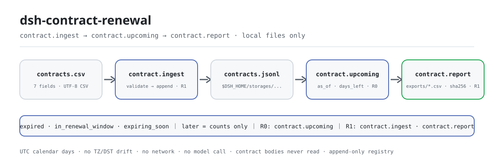
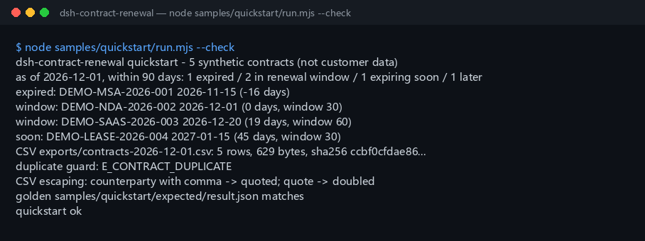

<div align="center">

<picture>
  <source media="(prefers-color-scheme: dark)" srcset="docs/assets/dsh-contract-renewal-flow-dark.svg">
  
</picture>

# dsh-contract-renewal

**Registra contratos → mira vencidos / ventana de renovación / próximos a vencer en una fecha → exporta CSV.**

Una herramienta de registro de vencimientos de contratos puramente local para DeepSeek Harness: siete campos por fila, tres grupos mutuamente excluyentes y los días restantes de un vistazo — solo aritmética de fechas y registro, sin analizar el texto del contrato, sin recordatorios y sin red.

[Instalar](#instalación-en-tres-pasos) · [Configuración](#configuración) · [FAQ](#faq) · [简体中文](README.md) · [English](README.en.md) · [Español](README.es.md) · [Português](README.pt.md) · [हिन्दी](README.hi.md)

[](LICENSE)
[](#compatibilidad)
[](https://www.npmjs.com/package/dsh-contract-renewal)
[](https://github.com/PerryLink/dsh-contract-renewal/actions/workflows/ci.yml)
[](#compatibilidad)

[](https://github.com/PerryLink/dsh-contract-renewal/stargazers)
[](https://www.npmjs.com/package/dsh-contract-renewal)
[](https://dshfind.com/plugins/PerryLink/dsh-contract-renewal?ref=badge)
[](https://gitee.com/perrylink/dsh-contract-renewal)

```sh
dsh plugin --profile <profile> add dsh-contract-renewal
```

</div>

<sub>Plugin de la comunidad, no afiliado a DeepSeek. Repositorio canónico: <https://github.com/PerryLink/dsh-contract-renewal> (Gitee es un espejo); los repositorios con el mismo nombre en otras cuentas no están relacionados.</sub>

<sub>Estado: alpha / público sintético / partial / not counted / no GA — sin datos de clientes, sin evidencia de clientes y sin afirmación de disponibilidad en producción.</sub>

## Qué es

En una frase: guarda en local un registro de metadatos de contratos (número, contraparte, fechas de inicio y fin, días de ventana de renovación, responsable e importe), lo proyecta sobre una fecha `as_of` en tres grupos — vencidos, en ventana de renovación y a vencer en N días — con los días restantes, y luego exporta CSV.

> Solo hace aritmética de fechas y del registro. **No** analiza el texto del contrato, no juzga cláusulas, no envía recordatorios y no sustituye el consejo legal.

- **Encaja**: un equipo legal, de compras o de administración con un lote de contratos que necesita una visión coherente de «qué ya venció y qué hay que renovar»; una lista de vencimientos que pasar a un revisor; un CSV local para analizar o cargar en otro sistema.
- **No encaja**: analizar PDF/Word de contratos (usa `dsh-legal-clause`); recibir y deduplicar correo (usa `dsh-legal-intake`); enviar automáticamente correos de renovación o llamar a un OA/CLM; un sistema de contratos multiinquilino con aprobaciones y permisos por rol; decidir si un contrato debe renovarse.

## Instalación en tres pasos

1. **Instala** (elige un canal):

   ```sh
   # canal npm (recomendado, versiones publicadas)
   dsh plugin --profile <profile> add dsh-contract-renewal
   # canal git (último main; equivale a git+https://github.com/PerryLink/dsh-contract-renewal.git)
   dsh plugin --profile <profile> add github:PerryLink/dsh-contract-renewal
   # canal tarball: pnpm pack en este repo y luego
   dsh plugin --profile <profile> add ./dsh-contract-renewal-<version>.tgz
   ```

2. **Configuración mínima** (no hay claves de Config; `cordis.patch.yml` inserta esta única fila):

   ```yaml
   - insert:
       - id: dsh-contract-renewal
         name: dsh-contract-renewal
   ```

3. **Verifica que se monta**:

   ```sh
   dsh --profile <profile> --dump-config | grep dsh-contract-renewal
   node samples/quickstart/run.mjs --check
   ```

**Desinstalar**: `dsh plugin --profile <profile> remove dsh-contract-renewal` (o elimina la fila del patch del perfil).

## Capacidades principales

Los nombres de las herramientas son una API estable; las descripciones se mantienen en inglés para coincidir con la salida en tiempo de ejecución.

| Herramienta | Para qué sirve | Riesgo |
|---|---|---|
| `contract.ingest` | Registra un contrato en `contracts.jsonl`; códigos estables para fechas inválidas o duplicados | R1 local write |
| `contract.upcoming` | Agrupa por `as_of` con `days_left`; por defecto hoy (UTC) y 90 días | R0 |
| `contract.report` | Exporta un CSV con comillas escapadas y devuelve ruta, sha256, filas y bytes | R1 local write |

- **Tres grupos excluyentes, una fila por contrato** — `expired`, `in_renewal_window` y `expiring_soon` (a vencer en N días pero todavía fuera de la ventana); el resto solo se cuenta en `counts.later`, sin doble conteo.
- **Registro local de solo adición** — un objeto JSON por línea en `$DSH_HOME/storages/dsh-contract-renewal/contracts.jsonl`; los archivos de contrato nunca se leen ni se modifican, y una renovación se registra con un número nuevo para conservar el historial.
- **Días de calendario UTC** — cada fecha se convierte a número de día UTC antes de restar, así que la zona horaria local, el horario de verano y `TZ` no pueden desplazar un resultado.
- **Exportación CSV verificable** — comillas RFC 4180 más `sha256`, número de filas y de bytes; el nombre del archivo debe ser un único componente seguro y las rutas que escapan se rechazan.
- **Fallo cerrado** — fechas inválidas, duplicados, ventanas fuera de rango y rutas inseguras devuelven `<frase humana>（E_CONTRACT_XXX）｜Next: <una acción>` en lugar de fallar en silencio.

### Límites exactos de los grupos

1. `end_date < as_of` → `expired`, con `days_left` negativo.
2. `0 ≤ days_left ≤ renewal_window_days` → `in_renewal_window`; tanto 0 (vence hoy) como el tamaño de la ventana están dentro.
3. Fuera de la ventana y `days_left ≤ within_days` → `expiring_soon`; exactamente `within_days` está dentro, `within_days + 1` no.
4. Todo lo demás → `later`, se cuenta pero no se devuelve.

## Entrada

- Un CSV de registro o una llamada a `contract.ingest` por contrato. Cada fila tiene siete campos:
  `contract_no` (único), `counterparty`, `start_date`, `end_date` (estricto `YYYY-MM-DD`), `renewal_window_days` (entero 0–3650), `owner`, `amount` (no negativo, como máximo dos decimales).
- Las fechas deben ser fechas ISO reales. `2026-02-30`, `2026-13-01` y `2026/12/01` fallan con `E_CONTRACT_DATE_INVALID`.
- Los números de contrato son únicos sin distinguir mayúsculas dentro de un mismo registro; un duplicado falla con `E_CONTRACT_DUPLICATE`.
- El registro vive en `$DSH_HOME/storages/dsh-contract-renewal/contracts.jsonl` (un objeto JSON por línea). Los archivos de contrato nunca se leen ni se modifican.

## Salida

- `contract.ingest`: `{ contract_no, counterparty, start_date, end_date, renewal_window_days, owner, amount, total }`, donde `total` es el número de filas del registro.
- `contract.upcoming`: `{ as_of, within_days, expired, in_renewal_window, expiring_soon, counts }`; cada elemento lleva `days_left` (negativo = vencido) y `status`.
- `contract.report`: ruta, nombre de archivo, `sha256`, número de filas, bytes y `as_of`; el CSV se escribe en `$DSH_HOME/storages/dsh-contract-renewal/exports/`.

Los tres grupos son **mutuamente excluyentes**: un contrato aparece como máximo una vez para un `as_of` dado:

| Grupo | Regla | Nota |
|---|---|---|
| `expired` | `days_left < 0` | Siempre se lista, por muy antiguo que sea el vencimiento |
| `in_renewal_window` | `0 ≤ days_left ≤ renewal_window_days` | La ventana de renovación tiene prioridad sobre el grupo «N días» |
| `expiring_soon` | fuera de la ventana y `days_left ≤ within_days` | Vence en N días pero aún no está en la ventana |
| no devuelto | todo lo demás | Solo se cuenta en `counts.later` |

`as_of` por defecto es **hoy (UTC)**; `within_days` por defecto es 90. Toda la aritmética usa días de calendario UTC, así que la zona horaria local, el horario de verano y `TZ` no pueden desplazar un resultado.

## Ejemplo

Copia esta frase:

> Registra estos 5 contratos y, con fecha 2026-12-01, dime cuáles están vencidos, cuáles están en la ventana de renovación y cuáles vencen en 90 días; luego exporta un CSV.

### Llamadas a las herramientas

```sh
# 1) registra un contrato
#    superficie de herramientas: contract.ingest({ contract_no: "DEMO-MSA-2026-001",
#                  counterparty: "…", start_date: "2026-01-01", end_date: "2026-11-15",
#                  renewal_window_days: 60, owner: "王敏", amount: 128000 })

# 2) mira una fecha
#    superficie de herramientas: contract.upcoming({ as_of: "2026-12-01", within_days: 90 })

# 3) exporta CSV
#    superficie de herramientas: contract.report({ as_of: "2026-12-01", filename: "contracts-2026-12-01.csv" })
```

Vuelve a ejecutar la muestra incluida y comprueba el archivo dorado:

```sh
node samples/quickstart/run.mjs --check
```



La muestra son cinco contratos sintéticos `DEMO-*` con `as_of=2026-12-01` y `within_days=90`:

```text
expired: DEMO-MSA-2026-001 2026-11-15 (-16 days)
window:  DEMO-NDA-2026-002 2026-12-01 (0 days, window 30)
window:  DEMO-SAAS-2026-003 2026-12-20 (19 days, window 60)
soon:    DEMO-LEASE-2026-004 2027-01-15 (45 days, window 30)
later:   DEMO-SUPPORT-2026-005 2027-03-31 (120 days) — solo en counts.later
```

`samples/quickstart/expected/result.json` es la salida real de `node samples/quickstart/run.mjs --json`, no está escrito a mano; la captura es la salida real de terminal de `--check` (registro original en [`docs/assets/quickstart.log`](docs/assets/quickstart.log)).

Dos contrapartes de la muestra contienen a propósito una coma y una comilla — `Northwind "APAC" Ltd.` y un nombre de empresa chino con una coma incrustada — para ejercitar los dos escapes de CSV; volver a registrar el primer contrato devuelve `E_CONTRACT_DUPLICATE`.

## Configuración

Este plugin **no tiene claves de Config**: `cordis.patch.yml` solo inserta la fila de arriba y las tres herramientas están disponibles en cuanto se monta. Todo lo ajustable vive en los parámetros de llamada:

| Herramienta | Parámetro | Obligatorio | Por defecto | Significado |
|---|---|---|---|---|
| `contract.ingest` | los siete campos del contrato | sí | — | número, contraparte, fechas de inicio y fin, ventana de renovación, responsable, importe |
| `contract.upcoming` | `as_of` | no | hoy (UTC) | fecha de referencia, `YYYY-MM-DD`; pásala explícitamente para reproducir «hoy» |
| `contract.upcoming` | `within_days` | no | `90` | la N de «vence en N días», entero 0–3650 |
| `contract.report` | `as_of` | no | hoy (UTC) | fecha de referencia usada para la exportación |
| `contract.report` | `within_days` | no | `90` | la N usada para la exportación |
| `contract.report` | `filename` | no | `contracts-<as_of>.csv` | solo `[A-Za-z0-9._-]`; sin rutas |

Ejemplo de profile patch (sin bloque config, solo la fila de identidad):

```yaml
- insert:
    - id: dsh-contract-renewal
      name: dsh-contract-renewal
```

Las pruebas pueden sobrescribir la raíz de escritura local con la variable de entorno `DSH_CONTRACT_HOME`; el valor por defecto es exactamente `$DSH_HOME/storages/dsh-contract-renewal`.

## FAQ

<details>
<summary>¿Por qué siguen apareciendo contratos vencidos antiguos?</summary>

Exponer las renovaciones olvidadas es precisamente el objetivo del grupo `expired`, así que no se recorta con `within_days`. Los elementos se ordenan por `days_left`, el más vencido primero.

</details>

<details>
<summary>¿Puede un contrato aparecer a la vez en «vence en N días» y en «ventana de renovación»?</summary>

No. Los grupos son mutuamente excluyentes: primero vencidos, luego ventana de renovación y por último el grupo de N días. Si `within_days=30` pero un contrato tiene una ventana de 60 días, sigue en `in_renewal_window` incluso con 45 días restantes.

</details>

<details>
<summary>¿Puede una zona horaria desplazar una fecha un día?</summary>

No. Las fechas se convierten a números de día UTC antes de restar; no hay aritmética de hora local ni de horario de verano. Si se omite `as_of`, se usa el hoy UTC. La suite de pruebas ejecuta los mismos datos con `TZ=UTC`, `America/Los_Angeles` y `Pacific/Kiritimati` y compara la salida byte a byte.

</details>

<details>
<summary>¿Cómo actualizo un contrato renovado?</summary>

El registro es de solo adición. Registra un número nuevo, por ejemplo `DEMO-MSA-2026-001-v2`, y conserva la fila antigua como historial. No edites `contracts.jsonl` a mano.

</details>

<details>
<summary>¿Lee el PDF, envía recordatorios o sube algo?</summary>

No. Solo calcula fechas e importes del registro: sin analizar el cuerpo del contrato, sin correo ni OA, sin red y sin llamadas al modelo. Para cobertura de cláusulas usa `dsh-legal-clause`.

</details>

## Permisos y datos

Lectura: el CSV de registro de contratos que indique el usuario (muestra: `samples/quickstart/input/contracts.csv`); ningún otro directorio, ningún archivo de cuerpo de contrato.  
Escritura: `$DSH_HOME/storages/dsh-contract-renewal/` (`contracts.jsonl` y `exports/*.csv`); los archivos originales no se tocan.  
Red: no.  
Sistemas externos: ninguno.

`contract.upcoming` es **R0** (solo lectura); `contract.ingest` y `contract.report` son **R1** (escritura local, limitada al directorio anterior). `DSH_CONTRACT_HOME` sobrescribe la raíz de escritura local para las pruebas; el valor por defecto es exactamente `$DSH_HOME/storages/dsh-contract-renewal`.

## Códigos de error

| Código | Cuándo aparece | Siguiente paso |
|---|---|---|
| `E_CONTRACT_DATE_INVALID` | una fecha no es un `YYYY-MM-DD` real (por ejemplo `2026-02-30`, `2026/12/01` o una cadena ISO con hora) | usa `YYYY-MM-DD` estricto y una fecha que exista |
| `E_CONTRACT_DUPLICATE` | el número ya existe en el registro (sin distinguir mayúsculas) | registra un número nuevo para la renovación (por ejemplo `-v2`) y conserva el historial |
| `E_CONTRACT_DATE_RANGE` | la fecha de fin es anterior a la de inicio | comprueba si `start_date` / `end_date` están intercambiadas |
| `E_CONTRACT_WINDOW_INVALID` | la ventana de renovación o el umbral de N días no es un entero 0–3650 | pasa un entero 0–3650, por ejemplo `renewal_window_days: 60` |
| `E_CONTRACT_AMOUNT_INVALID` | el importe es negativo, tiene más de dos decimales o supera 1e12 | usa un número simple con dos decimales como máximo; escribe `0` si no lo hay |
| `E_CONTRACT_FIELD_REQUIRED` / `E_CONTRACT_FIELD_INVALID` | un campo obligatorio está vacío, o un nombre tiene saltos de línea/tabuladores o es demasiado largo | rellena el campo; contraparte ≤200 caracteres, responsable ≤120 |
| `E_CONTRACT_NO_INVALID` | el número no empieza por letra/dígito o contiene otros caracteres (máx. 64) | reescríbelo, por ejemplo `DEMO-MSA-2026-001` |
| `E_CONTRACT_STORE_FAILED` | el registro no se puede leer o escribir | asegúrate de que `$DSH_HOME/storages/dsh-contract-renewal` sea escribible |
| `E_CONTRACT_EXPORT_FAILED` / `E_CONTRACT_PATH_INVALID` / `E_CONTRACT_PATH_NOT_ALLOWED` | la escritura del CSV falló, el nombre no es seguro o la ruta se sale del directorio de exportación | pasa solo `[A-Za-z0-9._-]` como `filename` |

Formato del error: `<frase humana>（E_CONTRACT_XXX）｜Next: <una acción>`. El diagnóstico completo está en [TROUBLESHOOTING.md](TROUBLESHOOTING.md).

## Evidencia de aceptación

Los fixtures públicos/sintéticos están en `samples/quickstart/`; `ACCEPTANCE.csv` registra las comprobaciones (todo excepto la fila de quickstart es `counted=false`).

| req_id | metric | threshold | actual | pass | source | counted |
|---|---|---|---|---|---|---|
| CR-A03 | upcoming groups | 1 expired / 2 window / 1 soon / 1 later | 1/2/1/1 | true | public/synthetic | false |
| CR-A04 | window boundary days_left | -16\|0/30 | -16\|0/30 | true | public/synthetic | false |
| CR-A07 | CSV quoting | comma+quote escaped | escaped | true | public/synthetic | false |
| CR-QS01 | quickstart golden | 1/1 | 1 | true | synthetic/quickstart | true |

*Filas de aceptación respaldadas por fixtures, no una ejecución de cliente; no se inventa ninguna salida.*

## Límites y limitaciones conocidas

- Solo registro y aritmética de fechas; sin analizar el cuerpo del contrato, sin revisión de cláusulas ni juicio legal.
- Sin aviso automático de renovación; sin correo, OA, CLM, firma electrónica ni sistema externo.
- JSONL de solo adición: no hay actualización ni borrado in situ. Registra un número nuevo para una renovación.
- La unicidad no distingue mayúsculas (`toUpperCase()`); añade un sufijo si tu numeración las distingue.
- La validación del importe es no negativo, ≤ 2 decimales y ≤ 1e12; sin cambio de divisa, impuestos ni conversión de moneda.
- Las fechas se limitan a los años 1000–9999; las ventanas y `within_days` son enteros 0–3650.
- El CSV es solo RFC 4180; no se eliminan prefijos de fórmula. No abras CSV de origen desconocido en Excel.
- Solo muestras públicas/sintéticas; alpha/partial, not counted, no es una afirmación de GA ni de producción.

## Compatibilidad

| Dimensión | Estado |
|---|---|
| Harness | `dsh >=0.2.1-rc.3 <0.4.0` |
| Node | `>=24.9.0 <25` |
| Plataformas | Todas; solo archivos locales |
| Datos | Sin red, sin llamadas al modelo, sin subidas |

Versión actual `0.1.0`, 23 pruebas en verde (`node --test test/*.test.mjs`).

## Ecosistema y calidad

- [Espejo en Gitee](https://gitee.com/perrylink/dsh-contract-renewal) (espejo sincronizado; GitHub es el canónico)
- [Página del plugin en dshfind](https://dshfind.com/plugins/PerryLink/dsh-contract-renewal) (instalaciones y ranking)
- **Canal de la tienda 1024**: ejecuta `npm i -g dsh1024` y luego `dsh1024 plugin --profile <profile> add dsh-contract-renewal` (cuenta para el ranking de instalaciones de [deepseek1024.com](https://deepseek1024.com))
- [Guía de campo del ecosistema](https://perrylink.github.io/dsh-plugin-guide/): guía de desarrollo de plugins · datos de selección medidos · criterios de mantenimiento

## Proyectos relacionados

- [dsh-legal-intake](https://github.com/PerryLink/dsh-legal-intake) — recepción, deduplicación y clasificación de correo legal
- [dsh-legal-clause](https://github.com/PerryLink/dsh-legal-clause) — árbol de cláusulas y cobertura de 12 claves
- [dsh-contract-pack](https://github.com/PerryLink/dsh-contract-pack) — los tres plugins como un escenario de extremo a extremo

## Desarrollo

```sh
pnpm install
pnpm build && pnpm lint && pnpm typecheck
node --test test/*.test.mjs
node scripts/gate.mjs
```

Las imágenes del README las genera [`scripts/gen-readme-assets.py`](scripts/gen-readme-assets.py) (biblioteca estándar de Python, diagrama de flujo SVG puro, solo tokens de comandos, variantes clara y oscura) y se puede volver a ejecutar cuando haga falta; `docs/assets/quickstart.png` es una ejecución real capturada y se conserva junto con `docs/assets/quickstart.log`.

Topics: `dsh`, `dsh-plugin`, `deepseek-harness`, `deepseek`, `contract`, `renewal`, `expiry`, `legal`, `csv`, `perrylink`

## Familia y agradecimientos

Este proyecto es miembro de la familia de plugins de DeepSeek Harness mantenida por [PerryLink](https://github.com/PerryLink) (todos Apache-2.0). Si este plugin te resulta útil, **dale una estrella**: no desbloquea nada, pero ayuda a que la siguiente persona lo encuentre.

- [@PerryLink](https://github.com/PerryLink) — creador y mantenedor: registro de contratos y motor de fechas UTC, los tres grupos excluyentes, exportación CSV y seguridad de rutas, la muestra dorada de quickstart y la documentación en cinco idiomas.

## Licencia

[LICENSE](LICENSE) (Apache License 2.0) © 2026 dsh-contract-renewal contributors. Véase también `NOTICE`.

<p align="center"><sub>Apache-2.0 · Plugin de la comunidad, no afiliado a DeepSeek.</sub></p>
