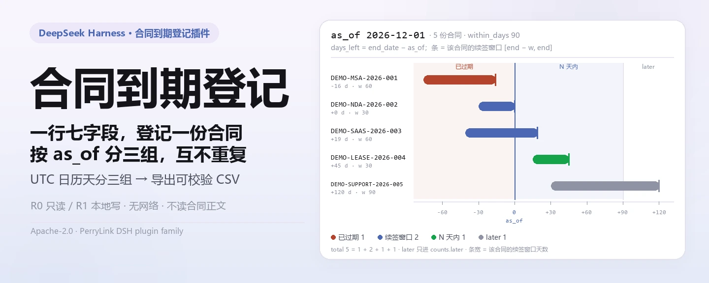
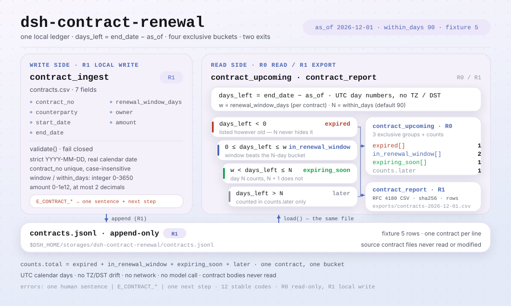

<div align="center">

<picture>
  <source media="(prefers-color-scheme: dark)" srcset="docs/assets/dsh-contract-renewal-hero-zh-dark.webp">
  
</picture>

# dsh-contract-renewal

**登记合同 → 按指定日期看已过期 / 续签窗口 / N 天内到期 → 导出 CSV。**

面向 DeepSeek Harness 的纯本地合同到期登记工具：七个字段一行，三组互斥、剩余天数一目了然，只做日期与登记表计算——不解析合同正文、不发提醒、不联网。

[安装](#三步上手) · [配置](#配置) · [FAQ](#faq) · [简体中文](README.md) · [English](README.en.md) · [Español](README.es.md) · [Português](README.pt.md) · [हिन्दी](README.hi.md)

[](LICENSE)
[](#兼容性)
[](https://www.npmjs.com/package/dsh-contract-renewal)
[](https://github.com/PerryLink/dsh-contract-renewal/actions/workflows/ci.yml)
[](#兼容性)

[](https://github.com/PerryLink/dsh-contract-renewal/stargazers)
[](https://www.npmjs.com/package/dsh-contract-renewal)
[](https://dshfind.com/plugins/PerryLink/dsh-contract-renewal?ref=badge)
[](https://gitee.com/perrylink/dsh-contract-renewal)

```sh
dsh plugin --profile <profile> add dsh-contract-renewal
```

</div>

<sub>社区插件，与 DeepSeek 官方无关。唯一官方仓库：<https://github.com/PerryLink/dsh-contract-renewal>（Gitee 为镜像），其他账号下的同名仓库与本项目无关。</sub>

<sub>状态：alpha / 公开合成 / partial / not counted / 非 GA——不含客户数据、客户证据，也不作生产可用声明。</sub>

## 它是什么

一句话：把合同的编号、对方、起止日、续签窗口天数、负责人和金额登记到本地，按某个 `as_of` 日期分成「已过期 / 已进入续签窗口 / N 天内到期」三组并给出剩余天数，再导出 CSV。

> 只做日期与登记表计算，**不解析合同正文、不判断条款、不发提醒、不替代法务意见**。

- **适合**：法务/采购/行政手里有一批合同，需要按统一口径看「哪些已经过期、哪些该续签了」；要把登记表和到期清单交给同事复核；要把本地台账导出 CSV 再做透视或入库。
- **不适合**：解析合同 PDF/Word 正文、抽取条款（请用 `dsh-legal-clause`）；收邮件、去重、分派（请用 `dsh-legal-intake`）；自动发续签邮件或调用 OA/CLM；需要多租户、审批流、权限分级的生产合同系统；替代律师判断某份合同能不能续。

<picture>
  <source media="(prefers-color-scheme: dark)" srcset="docs/assets/dsh-contract-renewal-flow-v5-dark.svg">
   N → 只进 counts.later；两个出口：contract.upcoming 返回三组加 counts（R0），contract.report 把全部 5 行写成 CSV 并返回 sha256 / rows / bytes 到 exports/（R1）">
</picture>

## 三步上手

1. **安装**（三选一）：

   ```sh
   # npm 通道（推荐，已发布版本）
   dsh plugin --profile <profile> add dsh-contract-renewal
   # git 通道（最新 main；等价于 git+https://github.com/PerryLink/dsh-contract-renewal.git）
   dsh plugin --profile <profile> add github:PerryLink/dsh-contract-renewal
   # tarball 通道：本仓库 pnpm pack 后
   dsh plugin --profile <profile> add ./dsh-contract-renewal-<version>.tgz
   ```

2. **最小配置**（没有 Config 键，`cordis.patch.yml` 只插入这一行）：

   ```yaml
   - insert:
       - id: dsh-contract-renewal
         name: dsh-contract-renewal
   ```

3. **验证已生效**：

   ```sh
   dsh --profile <profile> --dump-config | grep dsh-contract-renewal
   node samples/quickstart/run.mjs --check
   ```

**卸载**：`dsh plugin --profile <profile> remove dsh-contract-renewal`（或从 profile patch 删掉该行）。

## 核心能力

工具名是稳定 API；工具说明保留英文以匹配运行时输出。

| 工具 | 用途 | 风险 |
|---|---|---|
| `contract.ingest` | 登记一份合同，写 `contracts.jsonl`；非法日期 / 重复编号有稳定错误码 | R1 local write |
| `contract.upcoming` | 按 `as_of` 分组并返回 `days_left`；默认今天（UTC）、90 天 | R0 |
| `contract.report` | 导出带引号转义的 CSV，返回路径、sha256、行数、字节数 | R1 local write |

- **三组互斥，一份合同只出现一次** —— `expired`（已过期）、`in_renewal_window`（已进续签窗口）、`expiring_soon`（N 天内到期但还没进窗口）；其余只进 `counts.later`，不会重复计数。
- **追加式本地登记表** —— 一行一份合同，落在 `$DSH_HOME/storages/dsh-contract-renewal/contracts.jsonl`；原合同文件不读、不改，续签用新编号保留历史。
- **UTC 日历天** —— 所有日期先转成 UTC 日序号再相减，不受本机时区、夏令时或 `TZ` 影响。
- **CSV 导出可校验** —— RFC 4180 引号转义，返回 `sha256`、行数与字节数；文件名只允许单段安全名字，越界路径直接拒绝。
- **失败关闭** —— 非法日期、重复编号、越界窗口、越权路径都返回 `<一句人话>（E_CONTRACT_XXX）｜下一步：<动作>`，不静默。

### 分组与边界的精确定义

1. `end_date < as_of` → `expired`，`days_left` 为负。
2. `0 ≤ days_left ≤ renewal_window_days` → `in_renewal_window`。`days_left = 0`（今天到期）和 `days_left = renewal_window_days`（窗口第一天）都算窗口内。
3. 不在窗口内且 `days_left ≤ within_days` → `expiring_soon`；`days_left = within_days` 恰好算 N 天内，`within_days + 1` 不算。
4. 其余 → `later`，只进 `counts.later`，不出现在三组里。

## 输入

- 一个合同登记表（CSV）或逐条调用 `contract.ingest`；每行 7 个字段：
  `contract_no`（唯一编号）、`counterparty`（对方名称）、`start_date`、`end_date`（严格 `YYYY-MM-DD`）、`renewal_window_days`（0–3650 的整数）、`owner`（负责人）、`amount`（非负数字，最多两位小数）。
- 日期必须是真实存在的 ISO 日期；`2026-02-30`、`2026-13-01`、`2026/12/01` 都会报 `E_CONTRACT_DATE_INVALID`。
- 合同编号在同一登记表内**不区分大小写**唯一；重复登记报 `E_CONTRACT_DUPLICATE`。
- 登记表存放在 `$DSH_HOME/storages/dsh-contract-renewal/contracts.jsonl`，一行一份合同；原合同文件不读、不改。

## 输出

- `contract.ingest`：`{ contract_no, counterparty, start_date, end_date, renewal_window_days, owner, amount, total }`，`total` 是登记表当前条数。
- `contract.upcoming`：`{ as_of, within_days, expired, in_renewal_window, expiring_soon, counts }`；每条含 `days_left`（负数=已过期）和 `status`。
- `contract.report`：CSV 文件路径、文件名、`sha256`、行数、字节数与 `as_of`；文件写到 `$DSH_HOME/storages/dsh-contract-renewal/exports/`。

三组**互斥**，每份合同在一个 `as_of` 下只出现一次：

| 分组 | 条件 | 说明 |
|---|---|---|
| `expired` | `days_left < 0` | 已过期，无论过期多久都会列出 |
| `in_renewal_window` | `0 ≤ days_left ≤ renewal_window_days` | 已进入续签窗口，窗口优先于「N 天内」 |
| `expiring_soon` | 不在窗口内，且 `days_left ≤ within_days` | N 天内到期但还没进窗口 |
| 不返回 | 其余 | 只在 `counts.later` 计数 |

`as_of` 默认取**今天（UTC）**，`within_days` 默认 90。日期运算全部使用 UTC 日历天，不受本机时区、夏令时或 `TZ` 影响。

## 示例

直接复制下面这句：

> 把这 5 份合同登记进来，按 2026-12-01 看哪些已过期、哪些进了续签窗口、90 天内到期，再导出一份 CSV。

### 工具面调用

```sh
# 1) 登记一份合同
#    工具面：contract.ingest({ contract_no: "DEMO-MSA-2026-001", counterparty: "…",
#             start_date: "2026-01-01", end_date: "2026-11-15",
#             renewal_window_days: 60, owner: "王敏", amount: 128000 })

# 2) 看某一天的三组
#    工具面：contract.upcoming({ as_of: "2026-12-01", within_days: 90 })

# 3) 导出 CSV
#    工具面：contract.report({ as_of: "2026-12-01", filename: "contracts-2026-12-01.csv" })
```

用自带样例复跑并核对金标：

```sh
node samples/quickstart/run.mjs --check
```


样例是 5 份合成合同（`DEMO-*`，无真实主体/金额），`as_of=2026-12-01`、`within_days=90`：

```text
expired: DEMO-MSA-2026-001 2026-11-15 (-16 days)
window:  DEMO-NDA-2026-002 2026-12-01 (0 days, window 30)
window:  DEMO-SAAS-2026-003 2026-12-20 (19 days, window 60)
soon:    DEMO-LEASE-2026-004 2027-01-15 (45 days, window 30)
later:   DEMO-SUPPORT-2026-005 2027-03-31 (120 days) — 只在 counts.later
```

金标 `samples/quickstart/expected/result.json` 由 `node samples/quickstart/run.mjs --json` 真实产生，不是手写；截图就是 `--check` 的真实终端输出（原始日志见 [`docs/assets/quickstart.log`](docs/assets/quickstart.log)）。

样例里的对方名称故意包含逗号和引号（`华东合成制造有限公司, 上海分公司`、`Northwind "APAC" Ltd.`），用来验证 CSV 两种转义；重复登记第一份合同会返回 `E_CONTRACT_DUPLICATE`。

## 配置

本插件**没有 Config 键**——`cordis.patch.yml` 只插入上面那一行，挂载后三个工具即可用；所有可调项都在工具调用参数上：

| 工具 | 参数 | 必填 | 默认 | 含义 |
|---|---|---|---|---|
| `contract.ingest` | 7 个合同字段 | 是 | — | 编号、对方、起止日、续签窗口、负责人、金额 |
| `contract.upcoming` | `as_of` | 否 | 今天（UTC） | 分组基准日，`YYYY-MM-DD`；显式传入可复现「今天」 |
| `contract.upcoming` | `within_days` | 否 | `90` | 「N 天内到期」的 N，0–3650 的整数 |
| `contract.report` | `as_of` | 否 | 今天（UTC） | 导出时的分组基准日 |
| `contract.report` | `within_days` | 否 | `90` | 导出时用的 N |
| `contract.report` | `filename` | 否 | `contracts-<as_of>.csv` | 只允许 `[A-Za-z0-9._-]`，不接受路径 |

profile patch 示例（没有 config 段，只有身份行）：

```yaml
- insert:
    - id: dsh-contract-renewal
      name: dsh-contract-renewal
```

测试可用环境变量 `DSH_CONTRACT_HOME` 覆盖本地写根目录；默认严格等于 `$DSH_HOME/storages/dsh-contract-renewal`。

## FAQ

<details>
<summary>为什么已过期的合同还会出现在列表里？</summary>

`expired` 分组就是要暴露漏续签的合同，所以不按 `within_days` 截断，过期多久都会列出。按 `days_left` 从最负开始排序，最严重的排在最前。

</details>

<details>
<summary>「N 天内到期」和「续签窗口」会不会重复算？</summary>

不会。三组互斥，先判过期，再判续签窗口，最后才判 N 天。即使 `within_days=30` 而某合同的续签窗口是 60 天，只要它还有 45 天到期，也归 `in_renewal_window`，不会同时进 `expiring_soon`。

</details>

<details>
<summary>日期会不会因为时区差一天？</summary>

不会。所有日期先转成 UTC 日序号再相减，不做本地时间/DST 运算；`as_of` 省略时也取 UTC 今天。测试用 `TZ=UTC`、`America/Los_Angeles`、`Pacific/Kiritimati` 三个时区跑同一组数据，结果逐字节一致。

</details>

<details>
<summary>合同续签了怎么更新？</summary>

登记表是追加式（append-only），不覆盖历史。请用新的合同编号登记，例如 `DEMO-MSA-2026-001-v2`，保留旧记录用于追溯；不要手工改 `contracts.jsonl`。

</details>

<details>
<summary>会读合同 PDF、发提醒或上传数据吗？</summary>

都不会。它只算登记表里的日期和金额，不读合同正文、不发邮件/OA、不联网、不调用模型。条款覆盖请配合 `dsh-legal-clause` 使用。

</details>

## 权限与数据

读：用户指定的合同登记 CSV（样例：`samples/quickstart/input/contracts.csv`）；不读其他目录、不读合同正文文件。  
写：`$DSH_HOME/storages/dsh-contract-renewal/`（`contracts.jsonl` 与 `exports/*.csv`）；不改原文件。  
联网：否。  
外部系统：无。

`contract.upcoming` 标 **R0**（只读）；`contract.ingest` 与 `contract.report` 标 **R1**（本地写，只写上面的目录）。可用 `DSH_CONTRACT_HOME` 覆盖本地写根目录（测试用），默认严格等于 `$DSH_HOME/storages/dsh-contract-renewal`。

## 错误码

| 错误码 | 何时出现 | 下一步 |
|---|---|---|
| `E_CONTRACT_DATE_INVALID` | 日期不是真实的 `YYYY-MM-DD`（如 `2026-02-30`、`2026/12/01`、带时间的串） | 改成严格的 `YYYY-MM-DD`，并确认日期真实存在 |
| `E_CONTRACT_DUPLICATE` | 同一登记表已有该编号（比较时不分大小写） | 续签/改签换新编号（如 `-v2`）登记，保留历史 |
| `E_CONTRACT_DATE_RANGE` | 到期日早于起始日 | 检查 `start_date` / `end_date` 是否写反 |
| `E_CONTRACT_WINDOW_INVALID` | 续签窗口或统计天数不是 0–3650 的整数 | 传 0–3650 的整数，如 `renewal_window_days: 60` |
| `E_CONTRACT_AMOUNT_INVALID` | 金额为负、超过两位小数或超过 1e12 | 写成纯数字，最多两位小数；没有金额写 `0` |
| `E_CONTRACT_FIELD_REQUIRED` / `E_CONTRACT_FIELD_INVALID` | 必填字段为空，或名称含换行/制表符/超长 | 补齐字段；对方 ≤200 字、负责人 ≤120 字 |
| `E_CONTRACT_NO_INVALID` | 编号格式不对（须字母或数字开头，只含字母、数字、点、下划线、连字符，≤64 位） | 按业务编号规范改写，例如 `DEMO-MSA-2026-001` |
| `E_CONTRACT_STORE_FAILED` | 登记表读不出来或写不进去 | 确认 `$DSH_HOME/storages/dsh-contract-renewal` 可写 |
| `E_CONTRACT_EXPORT_FAILED` / `E_CONTRACT_PATH_INVALID` / `E_CONTRACT_PATH_NOT_ALLOWED` | CSV 没写出去、文件名不安全或路径越界 | 只传 `[A-Za-z0-9._-]` 组成的文件名 |

报错原文格式：`<一句人话>（E_CONTRACT_XXX）｜下一步：<一个动作>`。更多排查见 [TROUBLESHOOTING.md](TROUBLESHOOTING.md)。

## 验收证据

公开/合成 fixture 在 `samples/quickstart/`；`ACCEPTANCE.csv` 记录检查，除 quickstart 行外均为 `counted=false`。

| req_id | metric | threshold | actual | pass | source | counted |
|---|---|---|---|---|---|---|
| CR-A03 | upcoming groups | 1 expired / 2 window / 1 soon / 1 later | 1/2/1/1 | true | public/synthetic | false |
| CR-A04 | window boundary days_left | -16\|0/30 | -16\|0/30 | true | public/synthetic | false |
| CR-A07 | CSV quoting | comma+quote escaped | escaped | true | public/synthetic | false |
| CR-QS01 | quickstart golden | 1/1 | 1 | true | synthetic/quickstart | true |

*这是 fixture 支撑的验收行，不是客户运行；没有编造输出。*

## 边界与已知限制

- 只做登记表与日期计算，不解析合同正文、不校验条款、不做法律判断。
- 不自动发送续签提醒，不调用邮件、OA、CLM、电子签或任何外部系统。
- 登记表是追加式 JSONL，不提供原地更新/删除；续签请用新编号登记，避免丢历史。
- 编号唯一性按 `toUpperCase()` 比较；如果你的编号体系区分大小写，请在命名时自行加后缀区分。
- 金额只校验非负、最多两位小数和上限 1e12，不做币种换算、汇率或税务处理。
- 日期范围限定 1000–9999 年；`renewal_window_days` 与 `within_days` 限定 0–3650 的整数。
- CSV 只做 RFC 4180 引号转义，不做 Excel 公式前缀清洗；不要用 Excel 直接打开来源不明的 CSV。
- 仅公开/合成样例；alpha/partial、not counted，不作 GA 或生产可用声明。

## 兼容性

| 维度 | 状态 |
|---|---|
| Harness | `dsh >=0.2.1-rc.3 <0.4.0` |
| Node | `>=24.9.0 <25` |
| 平台 | 全平台；仅本地文件 |
| 数据 | 不联网、不调用模型、不上传 |

当前版本 `0.1.0`，23 项测试通过（`node --test test/*.test.mjs`）。

## 生态与质量

- [Gitee 镜像](https://gitee.com/perrylink/dsh-contract-renewal)（同步镜像，以 GitHub 为准）
- [dshfind 插件页](https://dshfind.com/plugins/PerryLink/dsh-contract-renewal)（安装量与排名）
- **1024 商店渠道**：先 `npm i -g dsh1024`，再 `dsh1024 plugin --profile <profile> add dsh-contract-renewal`（计入 [deepseek1024.com](https://deepseek1024.com) 安装排行）
- [生态实测知识库](https://perrylink.github.io/dsh-plugin-guide/)：插件开发指南 · 选型实测数据 · 维护取舍判据

## 相关项目

- [dsh-legal-intake](https://github.com/PerryLink/dsh-legal-intake) — 法务邮件收件、去重、分类
- [dsh-legal-clause](https://github.com/PerryLink/dsh-legal-clause) — 条款树与 12 项条款覆盖
- [dsh-contract-pack](https://github.com/PerryLink/dsh-contract-pack) — 把三个插件串成端到端场景

## 开发

```sh
pnpm install
pnpm build && pnpm lint && pnpm typecheck
node --test test/*.test.mjs
node scripts/gate.mjs
```

配图由 [`scripts/gen-readme-assets.py`](scripts/gen-readme-assets.py) 程序化生成：hero 用 Pillow 把五份样例合同画成续签窗口泳道，结构图是手写 SVG 的四档判定阶梯；数字直接读自 quickstart 金标 `samples/quickstart/expected/result.json`，深浅双版，可重复执行；`docs/assets/quickstart.png` 为真实运行截图，配合 `docs/assets/quickstart.log` 一并保留。

Topics：`dsh`, `dsh-plugin`, `deepseek-harness`, `deepseek`, `contract`, `renewal`, `expiry`, `legal`, `csv`, `perrylink`

## 家族与致谢

本项目是 [PerryLink](https://github.com/PerryLink) 维护的 DeepSeek Harness 插件家族成员（全部 Apache-2.0）。如果这个插件帮到了你，**给个 star**——它不解锁任何功能，但会让下一个人更容易找到它。

- [@PerryLink](https://github.com/PerryLink) —— 创建者与维护者：合同登记表与 UTC 日期引擎、三组互斥投影、CSV 导出与路径安全、quickstart 金标样例、五语文档。

## License

[LICENSE](LICENSE)（Apache License 2.0）© 2026 dsh-contract-renewal contributors。另见 `NOTICE`。

<p align="center"><sub>Apache-2.0 · 社区插件，与 DeepSeek 无关。</sub></p>
